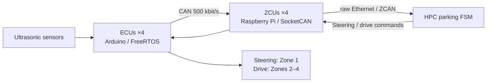

# Zonal Autoparking Controller

Ultrasonic-triggered, timed-maneuver parking FSM · [한국어](README.md)

This project documents my HPC parking-control design, integration and vehicle debugging during a three-day Zonal E/E workshop in July 2026. I specified the parking sequence, observed the vehicle, and directed revisions to sensing, state transitions, steering polarity and drive direction. Python implementation and edits were AI-assisted; the workshop supplied the ZCU/ECU baseline.

**The public Python code is a new portable reconstruction of my control design.** Historical programs recovered from a private July 8 session remain private because they include the workshop skeleton. [Provenance](docs/provenance.md) separates preserved files, replayed historical edits, hardware observations and the new implementation.



| Work | Evidence / implementation |
|---|---|
| My sequence | Detect right-side vehicle → forward 1 s → full-left forward 2.5 s → full-right reverse 3 s → straight reverse until rear distance <20 cm. [FSM and parameters](docs/parking-state-machine.md) |
| Integration | [HPC–ZCU–ECU roles, CAN IDs and message path](docs/architecture.md) |
| Debugging | [Missing/no-echo input, detection thresholds, steering polarity, Zone 3 inversion](docs/debugging.md) |
| Historical results | [Sensor reception, reverse-state entry and timeout stop; final parking success unknown](results/hardware-evidence.md) |
| Public model | [Pure FSM and direction/magnitude encoding](src/parking_controller.py) |
| Verification | [26 host regression tests](tests/test_controller.py), [synthetic demo output](results/model-demo.txt) |

Python 3.10+, no external dependencies:

```sh
python -m unittest discover -s tests -v
python -m src.demo
```

The demo uses synthetic sensors and sends no network or GPIO commands. Historical logs establish reception from four zones and entry into the earlier FSM's `REVERSE_TO_WALL` state, followed by timeout and a stop request. An early `PARKING DONE` print was accompanied by a report that the vehicle did not work. The v8 Zone 3 inversion edit is recoverable, but no post-fix vehicle run survives.

The new model adds monotonic time input, sensor freshness checks in the sensing states, a scan timeout, latched stop behavior and regression tests. These additions are host-tested only. The model does not establish actuator acknowledgement, ECU watchdog behavior or physical stopping. Timed maneuvers remain sensitive to speed, steering and track conditions; pose feedback and a new hardware validation campaign are future work.

New code and documentation use the [MIT License](LICENSE). Workshop sources, private transcripts and reconstructed historical runtime files are excluded.
