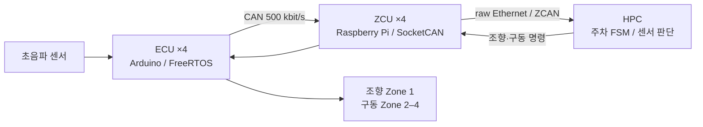

# Zonal Autoparking Controller

2026년 7월 Zonal 워크숍에서 수행한 HPC 주차 제어 설계·통합·실차 디버깅을 정리한 프로젝트입니다.

Ultrasonic-triggered, timed-maneuver parking FSM · [English](README.en.md)

초음파로 우측 차량을 감지한 뒤 전진·조향·후진을 시간으로 제어했습니다. 실물에서 센서 수신, 상태 전환, 조향 방향과 구동 모터의 방향 불일치를 확인하며 수정했습니다. 제공된 ZCU/ECU 통신 기반 위에서 주차 순서와 시험 조건을 정하고, AI 보조로 Python 제어 코드를 수정·통합했습니다.

**공개 `src/`는 당시 파일을 재배포한 것이 아니라 개인 설계를 바탕으로 새로 작성한 portable Python 모델입니다.** 2026-07-08 기록에서 복원한 실행 계보와 현재 모델을 [출처와 기여](docs/provenance.md)에서 구분합니다. 최종 주차 성공·정확도·통신 지연은 확인되지 않았습니다.



| 구분 | 내용 | 바로 보기 |
|---|---|---|
| 개인 설계 | 감지 → 1초 직진 → 좌측 풀조향 2.5초 전진 → 우측 풀조향 3초 후진 → 후방 거리 <20 cm까지 후진 | [상태 머신](docs/parking-state-machine.md) |
| 시스템 통합 | HPC–ZCU–ECU 역할, CAN ID, 센서와 구동기 경로 | [아키텍처](docs/architecture.md) |
| 현장 디버깅 | 0/4000 구분, 감지 임계값, 조향 반전, Zone 3 방향 보정 | [디버깅](docs/debugging.md) |
| 실물 근거 | 이전 FSM의 후진 진입·timeout 로그, 사용자 동작 관찰 | [확인된 결과](results/hardware-evidence.md) |
| 공개 코드 | 순수 상태 머신, 조향·Zone별 방향 변환, 실패 정지 | [src/parking_controller.py](src/parking_controller.py) |
| 검증 | 시간 경계·센서 이상·취소·극성 보정 회귀 테스트 | [tests/](tests/) |

## 실행

Python 3.10 이상, 외부 의존성 없이 실행합니다.

```sh
python -m unittest discover -s tests -v
python -m src.demo
```

데모는 합성 센서 입력을 사용하는 PC 실행 예입니다. 실제 차량·네트워크·GPIO를 제어하지 않습니다. [데모 출력](results/model-demo.txt)은 하드웨어 측정과 분리했습니다.

## 확인 범위

당시 로그는 네 Zone의 센서 프레임 수신과 이전 FSM의 `REVERSE_TO_WALL` 진입, timeout 후 정지 명령 출력을 보여줍니다. 초기의 `PARKING DONE` 출력은 실제 동작 실패 보고와 함께 남아 있어 성공 근거로 사용하지 않습니다. `parking_8.py`의 Zone 3 반전은 코드 수정까지 확인되며, 수정 후 실차 재시험 결과는 남아 있지 않습니다.

현재 모델에는 센서 freshness 검사, 탐색 timeout, 단조 시간 입력, 정지 상태 유지와 PC 회귀 테스트를 새로 추가했습니다. 이 기능들은 당시 차량에서 검증한 기능으로 표시하지 않습니다. 제공 펌웨어의 watchdog 유무와 차량 정지 보장은 별도 문제입니다.

## 한계와 다음 시험

시간 기반 기동은 차속·노면·배터리·조향 편차에 따라 결과가 달라집니다. 다음 실물 시험에서는 바퀴별 전후진 확인, 조향 중앙·좌우 보정, 센서 유효성, 통신 단절 시 ECU 정지를 먼저 확인한 뒤 거리·자세 피드백을 붙여야 합니다. 이 저장소는 위치 추정·경로 계획·폐루프 주차 제어 또는 차량 안전 검증 결과를 포함하지 않습니다.

코드 및 새 문서는 [LICENSE](LICENSE)의 MIT 조건으로 공개합니다. 강의 배포 소스, 복원한 과거 실행 코드와 비공개 대화 원문은 포함하지 않습니다.
