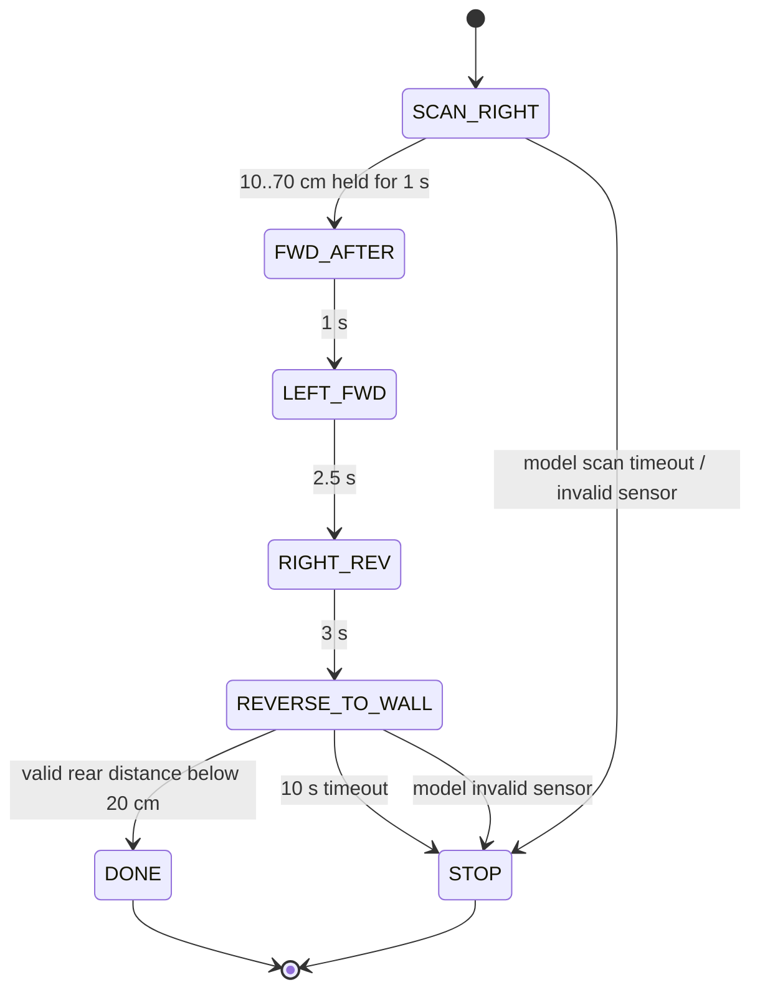

# Parking state machine

사용자가 실차 동작을 보고 지정한 다섯 단계가 v5부터 반영됐습니다. 처음에는 점유 차량의 끝을 기다리는 `PASS_EDGE` 구조였으나, 계속 직진하거나 주차 영역에 진입하지 못한다는 관찰을 바탕으로 감지 후 시간 기반 기동으로 바꿨습니다.

Operator stop and invalid-clock handling can latch STOP from any active state in the new model. The diagram's sensor/scan guards are reconstruction additions, not historical vehicle verification.

| State | Logical steer | Signed PWM request | Exit condition |
|---|---:|---:|---|
| SCAN_RIGHT | 0 | +55 | Right distance in inclusive [10,70] cm for 1 s continuously |
| FWD_AFTER | 0 | +50 | 1 s |
| LEFT_FWD | -12 | +50 | 2.5 s |
| RIGHT_REV | +12 | -45 | 3 s |
| REVERSE_TO_WALL | 0 | -45 | Valid rear distance strictly <20 cm; timeout at 10 s |
| DONE / STOP | 0 | 0 | Terminal; no automatic restart |

The PWM request is not a measured speed. Historical tuning constants were hardcoded in dictionaries; their values were selected for this small testbed and are not portable vehicle calibration.

## Historical behavior and new guards

| Item | Recovered historical code | Public reconstruction |
|---|---|---|
| 0 / missing rear | v2 could interpret 0 as arrival; v3 onward excludes nonpositive distance | Stop with reason; never DONE |
| 4000 | No echo / out of range; does not satisfy arrival threshold | Explicit `no-echo`; continue scanning/approach until timeout |
| Stale sensor | Age printed in diagnostics; no enforced freshness stop | Stop if right sample in SCAN_RIGHT or rear sample in REVERSE_TO_WALL is older than 0.5 s or in the future |
| Other implausible values | No full validity gate in final HPC branch | Accept 2..350 cm, otherwise STOP |
| Time base | `time.time()` and loop sleep | Supplied monotonic seconds; backward/nonfinite time → STOP |
| Scan limit | No scan timeout in v8 | 30 s timeout |
| On-state command | Historical send-on-change | Return command on each tick; no transport implied |

Timed states deliberately reproduce the open-loop maneuver structure. Their right/rear inputs are not used for obstacle avoidance. The new guards therefore do not provide continuous collision detection. One tick advances at most one timed state and starts its timer at that tick; a stalled caller does not skip maneuvers to catch up. Late host ticks can extend a motion request, so a physical adapter needs independent supervision.

At the rear timeout boundary STOP takes priority over a newly qualifying distance. Sensor values of 20 cm do not complete the sequence. Tests exercise these boundaries and the confirmation reset when the right-side detection disappears.
